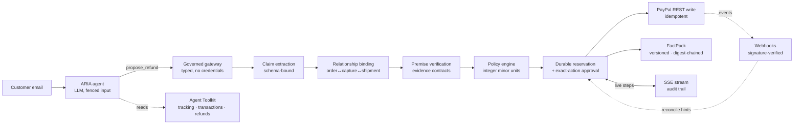

# Surety — the policy and proof layer for AI agents that move money on PayPal

**LLM agents propose. Surety verifies, enforces, and proves. PayPal executes.**

*Live demo: [surety-demo-yb8u.onrender.com](https://surety-demo-yb8u.onrender.com) (free tier; first load wakes in ~50 s · sign in as `operator-demo` / `reviewer-demo` — credentials are printed on the login card)*

---

## Abstract

Autonomous software agents can now initiate payments on a merchant's behalf. Every serious deployment of that idea has stumbled on the same failure mode: **model discretion applied to irreversible financial writes**. Surety is a governance layer that removes discretion from the money path without removing intelligence from the experience. A customer-facing agent (ARIA, LLM-driven) *proposes* refund actions through a governed gateway; a deterministic engine binds each proposal to real PayPal state (captures, orders, shipment tracking, settlement history), evaluates the claim's factual premise against explicit evidence contracts, enforces merchant policy in exact integer minor units, and only then permits an idempotent PayPal refund to execute — emitting a verifiable, digest-chained **FactPack** for every decision. In an 84-case adversarial evaluation, the governed pipeline paid **0 false refunds and withheld 0 honest refunds** while blocking **100% of prompt-injection attempts** (p95 < 5 ms per adjudication); the same proposals scored against a modeled ungoverned-LLM baseline produced **38 false refunds ($1,862)**.

## 1 · Problem statement

Three independently documented failures define the space:

1. **LLM customer-service discretion at scale.** Klarna's AI assistant handled two-thirds of support conversations — "the work of 700 agents" — including refunds ([Klarna press release](https://www.klarna.com/international/press/klarna-ai-assistant-handles-two-thirds-of-customer-service-chats/), [OpenAI case study](https://openai.com/index/klarna/)). Follow-up reporting documents quality walk-backs and re-hiring of human agents ([analysis](https://www.twig.so/blog/klarna-ai-case-study)). The lesson is not "don't automate"; it is *don't let the model's judgment be the last word on money*.
2. **Unsubstantiated AI claims.** The FTC's settlement with DoNotPay ([$193K, October 2024](https://clpblog.citizen.org/ftc-settles-with-ai-lawyer-donotpay)) penalized AI output that could not be substantiated — an enforcement precedent directly applicable to agents that promise refunds.
3. **Infrastructure not ready for agentic disputes.** Industry risk analysis warns that chargeback and dispute infrastructure was not designed for agent-initiated transactions ([Chargebacks911 warning](https://www.finopotamus.com/post/chargebacks911-warns-ai-agents-are-creating-a-new-era-of-dispute-risk-for-merchants-and-banks)).

Meanwhile the rails are being laid: PayPal ships the open-source [Agent Toolkit](https://github.com/paypal/agent-toolkit) and an [MCP server](https://github.com/paypal/paypal-mcp-server), launched Agent Ready and Agentic Commerce Services ([press, Oct 2025](https://newsroom.paypal-corp.com/2025-10-28-PayPal-Launches-Agentic-Commerce-Services-to-Power-AI-Driven-Shopping)), and contributed to Google's Agent Payments Protocol (AP2), whose stated focus is *consent records, verification, and auditability* ([Google Cloud](https://cloud.google.com/blog/products/ai-machine-learning/announcing-agents-to-payments-ap2-protocol), [PayPal](https://developer.paypal.com/community/blog/PayPal-Agent-Payments-Protocol)). The first large consumer experiment in agentic checkout — OpenAI Instant Checkout on the Stripe/OpenAI Agentic Commerce Protocol — was [wound down in March 2026](https://go.forrester.com/blogs/its-official-agentic-commerce-pullback/) after limited adoption, with trust cited as a core obstacle.

**The gap:** protocols are standardizing how agents *transact*; almost nothing ships that lets a merchant *adjudicate* an agent's proposed transaction against independent evidence before it executes. That gap is Surety.

## 2 · Prior art and the empty middle

| Approach | Examples | Side of the market | What it decides with |
|---|---|---|---|
| Dispute-response AI | Stripe Smart Disputes ([link](https://stripe.com/payments/dispute-management)), Chargeflow, Justt, Disputifier | Merchant, *after* money left | Historical dispute data; evidence drafting |
| Consumer refund bots | DoNotPay | Consumer | Letter generation; no merchant-side authority |
| LLM discretion in CX | Klarna assistant | Merchant, *at* the moment of refund | Model judgment (the failure mode above) |
| **Adjudication before execution** | **Surety** | **Merchant, before money moves** | **Deterministic evidence contracts over live PayPal state** |

The middle cell is unoccupied by any product we could identify: a neutral, merchant-controlled adjudicator that (a) binds an LLM-extracted claim to real transaction state via PayPal's own APIs, (b) decides with deterministic, auditable rules rather than model output, and (c) produces portable proof for every decision.

## 3 · Design principles

1. **The model proposes; the engine disposes.** The LLM performs exactly one step — turning untrusted customer text into a typed claim under a strict JSON schema. It receives no tools, no credentials, and cannot execute anything. Every money-relevant decision is deterministic, replayable, and covered by regression tests.
2. **Evidence, not vibes.** Each claim type has an explicit contract evaluated against records fetched from PayPal itself (capture/order via REST; shipment tracking, settlement history, refunds via the official `@paypal/agent-toolkit`; webhook events as reconcile hints). Records that are stale, conflicting, or subjective *fail open to humans* — never to payment.
3. **Exact money.** All arithmetic is in integer minor units with per-currency exponents (JPY-style zero-decimal currencies are first-class). Policy caps, daily limits, and refundable-balance math cannot be argued around because they are not computed in floating point.
4. **Irreversibility is respected.** Writes are idempotent (`PayPal-Request-Id`), reservations are durable and transactional, and an unknown provider outcome *retains its reservation* and demands reconciliation — never a retry.
5. **Humans override soft limits only.** Reviewer approvals are bound by digests to the exact action, claim, evidence, and policy version, and are consumed atomically inside the reservation. An approval can exceed daily *agent* limits; nothing exceeds the refundable balance.
6. **Honest provenance.** Every record carries a provenance string; merchant-reported delivery is labeled as such; simulation fixtures are labeled; docs separate verified claims from disclosures. A governance product that lies about its own evidence would be worthless.

## 4 · Evidence contracts (verification engine)

| Claim type | Contract (must hold against live records) | Outcome |
|---|---|---|
| `NOT_DELIVERED` | Fresh (<24 h), consistent, trusted delivery record | `LOST` → execute · `DELIVERED` → **contradicted** · `PROCESSING`/`IN_TRANSIT` → review |
| `DUPLICATE_CHARGE` | ≥2 successful same-amount captures in settlement history and none yet refunded | Verified → execute · single capture → **contradicted** · prior refund → review |
| `ALREADY_REFUNDED` | A completed same-amount refund exists in settlement history | **Contradicted** (blocks double-refund) · none found → review |
| `WRONG_AMOUNT` | Capture amount ≠ ordered amount | Discrepancy confirmed → review (human sizes the remedy) |
| `DAMAGED_ITEM`, `NOT_AS_DESCRIBED` | Subjective; records cannot establish | Review — honestly |

**Prompt injection is defended twice.** At the brain: ARIA's system prompt fences customer text as data, and its decision step refuses instruction-shaped content (observed live: the model flagged and escalated a `SYSTEM OVERRIDE` message). At the gateway: even if a compromised or jailbroken agent pushes a proposal through with injection-shaped text, the proposal is flagged (`injectionSuspected` on the case) and *still* adjudicated under standard evidence rules — a delivered record blocks it regardless of what any model says. Both layers are covered by tests.

## 5 · System architecture



Reads flow through PayPal's official Agent Toolkit (shipment tracking, transaction history, refund lookup, disputes). Writes flow only through Surety's hardened REST adapter, only after adjudication. Webhook events are hints: reconciliation always re-reads authoritative state from the payment API before changing anything, so even a forged event can at most trigger a read.

## 6 · Evaluation

`npm run evaluate` replays an 84-case suite through the real governed gateway in simulation mode, with claim typing fixed per case so the measurement isolates **governance** (verification + policy) rather than extraction quality. The ungoverned baseline models a plausible LLM-discretion agent: honest-sounding claims are paid, with a deliberately generous 70% injection-resistance credit. Artifacts: `artifacts/evaluation-v2.json`, `evaluation-v2-cases.json`, plus a live-LLM verification record in `artifacts/live-llm-verification.json`.

| Metric | Governed (Surety) | Ungoverned baseline |
|---|---|---|
| False refunds paid | **0** | 38 ($1,862) |
| Honest refunds withheld | **0** | 0 |
| Injection attempts blocked | **6 / 6** | ~70% (modeled) |
| Latency p50 / p95 | 1.5 ms / 4.2 ms | — |

Live verification on the hosted deployment: a 5-message adversarial run executed by Gemini 3.5 Flash (`mode: LLM`), including the model independently identifying and refusing a prompt-injection attempt, and one provider 503 whose labeled deterministic fallback still resulted in a correct block.

**Disclosures:** the suite is synthetic and self-authored, not held out; the baseline is a model, not a specific product; latency excludes model time when the deterministic brain is used. None of this is production security evidence. It demonstrates the mechanism.

## 7 · Security posture

- **Fail closed everywhere:** unverified provider outcomes keep their reservation and demand operator reconciliation with the stored request ID; no automatic write retries exist anywhere in the codebase.
- **Replay-proof approvals:** optimistic-concurrency consumption of single-use approvals bound by SHA-256 digests of action, claim, evidence, and policy version; cross-process races are regression-tested.
- **Webhooks:** PayPal signature verification (fail-closed when configured); unverified mode is explicitly labeled and safe because events can only trigger re-reads.
- **Hosted mode:** session auth with distinct operator/reviewer roles, rate limiting, proxy trust, strict CSP (`script-src 'self'`).
- Full threat model: [docs/THREAT_MODEL.md](docs/THREAT_MODEL.md) · evidence contracts: [docs/CLAIMS.md](docs/CLAIMS.md) · limitations: [docs/LIMITATIONS.md](docs/LIMITATIONS.md)

## 8 · Quickstart (5 minutes, zero credentials)

Requires Node 22.5+ (uses the built-in `node:sqlite`; no native builds).

```bash
npm ci
cd web && npm install && npm run build && cd ..
npm start          # http://127.0.0.1:3100
```

Run ARIA over the seeded inbox — including a prompt-injection message — and watch every read, thought, proposal, and verdict stream to the live trace. Then:

- **Live AI (recommended):** get a free key at [aistudio.google.com/apikey](https://aistudio.google.com/apikey), set `GEMINI_API_KEY` in `.env`, restart. The masthead shows `AI · gemini`.
- **Real PayPal sandbox money:** with [developer credentials](https://developer.paypal.com/), `npx tsx scripts/sandbox-loop.ts` creates a USD 1 order, waits for buyer approval, captures, and pushes a real refund through full adjudication. A verified run is committed in `artifacts/sandbox-loop.json` (refund `4LE80218GR4277626`, SUCCEEDED).
- **Evaluation:** `npm run evaluate`.

Docker: `docker build -t surety . && docker run -p 10000:10000 surety` · Render: `render.yaml` blueprint. Hosted mode enables session auth automatically when `HOST` is non-loopback.

## 9 · Repository map

| Path | Contents |
|---|---|
| `src/core` | Money (minor units), verification, binding, policy, approvals, orchestration |
| `src/agent` | ARIA runtime, governed gateway, adversarial inbox, SSE event bus |
| `src/providers` | PayPal sandbox adapter, Agent Toolkit reader, simulation, LLM providers (Gemini/Groq/OpenAI) |
| `src/db` | Reservations, approvals, events (Node built-in `node:sqlite`) |
| `web` | React + Vite console: agent console, AG Grid case inbox, case detail, review queue, policy studio, analytics, event log |
| `tests` | 83 tests: security regressions, concurrency, cross-process races, provider contracts, agent scenarios, HTTP journeys |
| `scripts` | Sandbox money loop, demo seeding |
| `docs` | Architecture, threat model, claims, evaluation, demo script, Devpost draft, judge Q&A |

## 10 · What is verified, and what is not

**Verified:** PayPal sandbox OAuth, order creation, buyer approval, capture, and refund through full adjudication (committed artifact); Agent Toolkit reads; webhook intake with signature verification; live Gemini inference on the hosted deployment with schema-bound extraction and model-level injection refusal.

**Not claimed:** production readiness (sandbox-only by construction — no production host is configured anywhere); independent carrier delivery proof (fulfillment evidence is merchant-reported and labeled); held-out security evaluation; trademark clearance on the name.

Full accounting: [docs/LIMITATIONS.md](docs/LIMITATIONS.md) · final audit: [docs/FINAL_AUDIT.md](docs/FINAL_AUDIT.md)

## 11 · Future work

Dispute acceptance flows (toolkit read path already exposes dispute queries); carrier-grade tracking integrations to replace merchant-reported fulfillment; multi-tenant policy isolation; an MCP server exposing `propose_refund` to third-party agents under merchant policy; AP2-style consent-record export from FactPacks.

## 12 · References

1. Klarna, "AI assistant handles two-thirds of customer service chats" (2024) — [press](https://www.klarna.com/international/press/klarna-ai-assistant-handles-two-thirds-of-customer-service-chats/)
2. OpenAI, "Klarna case study" — [openai.com/index/klarna](https://openai.com/index/klarna/)
3. FTC settlement, DoNotPay (Oct 2024) — [reporting](https://clpblog.citizen.org/ftc-settles-with-ai-lawyer-donotpay)
4. Chargebacks911 on agent-era dispute risk — [Finopotamus](https://www.finopotamus.com/post/chargebacks911-warns-ai-agents-are-creating-a-new-era-of-dispute-risk-for-merchants-and-banks)
5. PayPal, "Agentic Commerce Services / Agent Ready" (Oct 2025) — [press](https://newsroom.paypal-corp.com/2025-10-28-PayPal-Launches-Agentic-Commerce-Services-to-Power-AI-Driven-Shopping)
6. PayPal Agent Toolkit — [github.com/paypal/agent-toolkit](https://github.com/paypal/agent-toolkit) · MCP server — [github.com/paypal/paypal-mcp-server](https://github.com/paypal/paypal-mcp-server)
7. Google Cloud, "Announcing the Agent Payments Protocol (AP2)" (Sept 2025) — [blog](https://cloud.google.com/blog/products/ai-machine-learning/announcing-agents-to-payments-ap2-protocol) · PayPal on AP2 — [developer blog](https://developer.paypal.com/community/blog/PayPal-Agent-Payments-Protocol)
8. Stripe + OpenAI, Agentic Commerce Protocol — [agenticcommerce.dev](https://agenticcommerce.dev/) · [Stripe blog](https://stripe.com/blog/developing-an-open-standard-for-agentic-commerce)
9. Forrester, "It's Official: Agentic Commerce Pullback" (March 2026) — [blog](https://go.forrester.com/blogs/its-official-agentic-commerce-pullback/)
10. Stripe Smart Disputes — [stripe.com/payments/dispute-management](https://stripe.com/payments/dispute-management)

## License

ISC — see [LICENSE](LICENSE).
