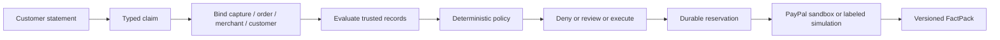

# SURETY — Premise-bound execution

**Agents can move money. Surety makes them prove why.**

A merchant support agent may be allowed to refund $49 even when the claim behind that refund is contradicted by delivery records. Surety binds the claim to the capture and order, evaluates evidence, applies policy, and records the decision before any provider write.

## Run locally

Requires Node.js 22 or later and npm. This Windows checkout was built with the installed runtime; see `node --version` for your environment.

```powershell
npm ci
npm test
npm run build
npm run evaluate
npm start
```

Open http://127.0.0.1:3100. Default mode is **SIMULATION**: seeded transactions, fixture claim extraction, simulated refunds. No credentials needed. Select delivered, lost, damaged, or processing; verify the premise; execute eligible cases or approve an exact review action; download its FactPack. Evaluation and execution are separate buttons. History survives restarts.

To rehearse against a fresh local store without deleting evidence:

```powershell
$env:DATABASE_PATH = "rehearsal-$(Get-Date -Format yyyyMMdd-HHmmss).db"
npm start
```

The old store remains intact. Do not share a database between simulation and sandbox modes.

## What works, and what is not verified

- Deterministic relationship checks, freshness/provenance checks, denial/review/execute decisions.
- Durable SQLite reservation before provider calls, exact-action approvals, one logical execution per case, balance and daily reservations, uncertain-outcome retention.
- Case UI, persistent snapshots, JSON evidence export, HTTP and provider-contract tests.
- PayPal sandbox OAuth authentication and real USD 1 order creation were verified on 2026-10-04. Buyer approval, capture and real refund remain pending. **No real refund success claimed.**
- OpenAI structured extraction adapter is implemented and contract-tested with stub responses. No real model inference has run. Paid API setup is deferred at the user's request; local model runtimes were not available.
- Self-authored 60-case synthetic specification evaluation is reproducible. It is not held out and is not production security evidence.

## Flow



Only a fresh, consistent LOST record supports automatic non-delivery refunds. DELIVERED contradicts that claim; PROCESSING and ambiguous states require review. Other claim types currently require investigation. Currency is USD only; amounts must have cent precision. Human approval cannot override relationship errors or contradicted premises. The model receives no payment tools or PayPal credentials.

## Sandbox configuration

Copy `.env.example` to `.env` without overwriting an existing credential file. Configure PayPal sandbox client credentials, distinct operator/reviewer tokens, and `MERCHANT_RECORDS_PATH`. All credentials remain server-side except operator/reviewer bearer tokens entered in the local access form. The app binds loopback and is not intended for public hosting without authentication and operational hardening.

`merchant-records.json` must be an array matching:

```json
[{"orderId":"REAL_ORDER_ID","captureId":"REAL_CAPTURE_ID","merchantId":"REAL_PAYEE_MERCHANT_ID","customerId":"YOUR_INTERNAL_CUSTOMER_ID","shipmentId":"YOUR_SHIPMENT_ID","fulfillmentState":"LOST","observedAt":"2026-10-04T12:00:00.000Z"}]
```

These are **merchant-reported records**, not independent carrier proof. Do not fabricate them for a real transaction. Sandbox experiments may use explicitly disclosed synthetic fulfillment attached to a real sandbox purchase.

`npx tsx scripts/sandbox-order.ts` creates or checks a USD 1 sandbox order and prints its buyer approval link. It never prints an access token. The buyer approves with a sandbox personal account. Then `npx tsx scripts/sandbox-validate.ts` checks approval and runs a USD 1 capture/refund through Surety, explicitly using synthetic fulfillment and a manual typed claim. No production API host is supported.

The adapter implements capture GET, order GET, refund POST with `PayPal-Request-Id`, and refund GET. Partially refunded or non-COMPLETED captures are refused because complete provider refund-history reconciliation is not yet implemented. Unknown write outcomes retain their reservation and require reconciliation; missing refund IDs require operator investigation, not automatic resubmission. Disputes and webhooks are not implemented.

## Optional model extraction

Set `OPENAI_API_KEY` and `OPENAI_MODEL` locally, then enable the AI checkbox. One request, 20-second timeout, strict JSON schema, no tools, no automatic retry. Invalid output, missing or conflicting references, refusal and network errors stop case creation. The original message and merchant/customer identity are supplied by the server; model-generated identity is not accepted. Fixture mode accepts only unchanged demonstration messages.

## Repository map

- `src/core`: binding, verification, policy, approvals and orchestration.
- `src/db`: SQLite approvals, reservations and versioned snapshots.
- `src/providers`: PayPal sandbox, simulation, structured claim extraction.
- `src/server.ts`: local Express API and access boundaries.
- `public`: responsive evidence docket.
- `tests`: regression, concurrency, provider and HTTP checks.
- `src/evaluation.ts`: synthetic four-baseline comparison; outputs to `artifacts/`.
- `docs`: architecture, threat model, evidence contracts, evaluation, demo, Q&A and audit.

See [limitations](docs/LIMITATIONS.md), [execution ledger](docs/EXECUTION_LEDGER.md), and [final audit](docs/FINAL_AUDIT.md). The name is provisional; similarly named AI products exist. No trademark clearance is claimed.

License: ISC. Existing package license retained.
